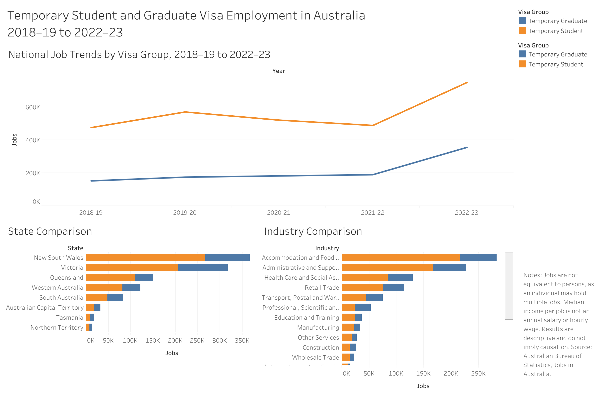
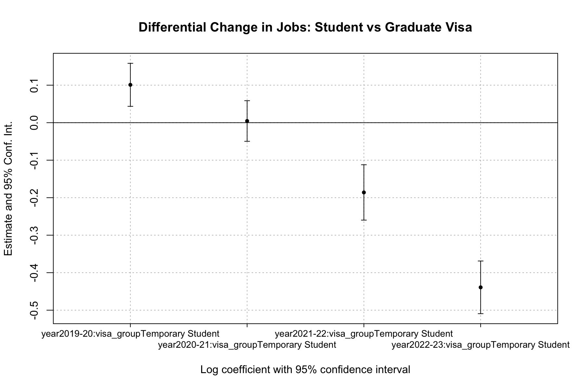
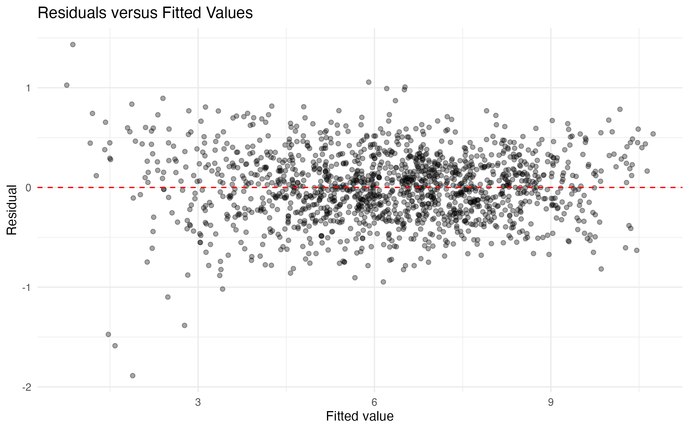

# Temporary Student and Graduate Visa Employment in Australia

A reproducible analysis of jobs held by temporary student and graduate visa holders across Australian states and industries from 2018–19 to 2022–23.

## Dashboard

[View the interactive Tableau dashboard](https://public.tableau.com/views/AustraliaStudentVisaEmploymentDashboard/1?:language=zh-CN&:sid=&:redirect=auth&:display_count=n&:origin=viz_share_link)





## Project Summary

This project investigates three questions:

1. How did the number of jobs held by temporary student and graduate visa holders change between 2018–19 and 2022–23?
2. Which states and industries accounted for the largest numbers of these jobs?
3. After controlling for persistent state-industry differences, did job-count changes for the Temporary Student group differ from those for the Temporary Graduate group?

The project combines Python data cleaning, R regression modelling and Tableau visualisation to produce a reproducible end-to-end analysis.

## Key Findings

### National trends

- Jobs held by Temporary Student visa holders increased from 476,081 in 2018–19 to 749,847 in 2022–23.
- Jobs held by Temporary Graduate visa holders increased from 152,465 to 355,883 over the same period.
- Both groups experienced particularly strong growth in 2022–23.
- New South Wales and Victoria recorded the largest absolute job counts.
- Temporary Student jobs were concentrated in industries including Accommodation and Food Services and Administrative and Support Services.

These are job counts rather than numbers of employed people or employment rates.

### Regression results

The model compares changes in state-industry job counts for Temporary Student and Temporary Graduate visa holders, using 2018–19 as the reference year.

| Financial year | Estimate | Approximate relative change | 95% confidence interval | Significance |
|---|---:|---:|---:|---|
| 2019–20 | 0.101 | 10.6% | 4.5% to 17.1% | p < 0.001 |
| 2020–21 | 0.004 | 0.4% | −4.8% to 6.0% | Not significant |
| 2021–22 | −0.186 | −17.0% | −22.8% to −10.7% | p < 0.001 |
| 2022–23 | −0.439 | −35.5% | −39.9% to −30.9% | p < 0.001 |

The estimates suggest that:

- In 2019–20, the Temporary Student group experienced an estimated 10.6% greater relative change than the Temporary Graduate group.
- In 2020–21, the estimated difference was close to zero and statistically insignificant.
- In 2021–22, the Temporary Student group experienced an estimated 17.0% lower relative change.
- In 2022–23, the relative difference widened to approximately −35.5%.

The negative 2022–23 coefficient does not mean that Temporary Student job counts declined. The descriptive data show that their absolute job count increased strongly. Instead, it means that the increase was smaller relative to the increase experienced by the Temporary Graduate group and the 2018–19 baseline.

A PPML robustness model produced a similarly negative and statistically significant 2022–23 estimate of approximately −32.1%, supporting the direction of the main result.

These estimates represent conditional associations, not causal effects.



## Model Diagnostics

A residual-versus-fitted plot was used to assess whether the log-linear
model showed strong non-linearity, unusual outliers or systematic changes
in residual dispersion.



The diagnostic plot is used as a visual model check rather than proof
that all regression assumptions are satisfied. State-industry clustered
standard errors were used to account for dependence and heteroskedasticity
within state-industry cells. A PPML model was also estimated because the
dependent variable is a non-negative job count.

## Data Source

The project uses Table 17 from the Australian Bureau of Statistics publication [Jobs in Australia](https://www.abs.gov.au/statistics/labour/jobs/jobs-australia/latest-release).

The source workbook provides annual data by:

- State or territory
- Visa group
- Applicant status
- Industry
- Sex
- Financial year
- Number of jobs
- Median income per job

The analysis covers 2018–19 to 2022–23.

## Data Preparation

The original ABS workbook was cleaned and reshaped in Python.

The pipeline:

1. Extracted Table 17 from the original Excel workbook.
2. Combined its multi-row headers.
3. Reshaped annual job and income columns into tidy long format.
4. Standardised variable names and data types.
5. Preserved confidential observations marked `np` as missing values.
6. Distinguished confidential values from nil or rounded-to-zero observations.
7. Validated selected national totals against the original workbook.
8. Exported processed CSV files for R and Tableau.

The full processed panel contains 47,700 observations and 11 variables.

## Regression Method

The regression sample retains:

- Temporary Student and Temporary Graduate visa groups
- Eight Australian states and territories
- Nineteen industries
- Five financial years
- Total applicant status
- Persons of all sexes

National totals and total-industry observations were excluded to avoid double counting. Observations with confidential job counts were treated as missing.

The final regression sample contains 1,506 state-industry-visa-year observations, with no duplicate panel cells.

The primary model is:

\[
\log(1+\mathrm{Jobs}_{sigt})
=
\alpha_{si}
+\lambda_t
+\gamma\mathrm{Student}_g
+\delta_t(\mathrm{Year}_t \times \mathrm{Student}_g)
+\varepsilon_{sigt}
\]

where:

- \(s\) denotes state or territory
- \(i\) denotes industry
- \(g\) denotes visa group
- \(t\) denotes financial year
- \(\alpha_{si}\) represents state-industry fixed effects
- 2018–19 is the reference year
- Temporary Graduate is the reference visa group

Standard errors are clustered by state-industry cell.

A Poisson pseudo-maximum-likelihood model was estimated as a robustness check because the dependent variable is a non-negative job count.

## Limitations

- Jobs do not represent unique people. One person may hold multiple or consecutive jobs during a financial year.
- Median income per job is not an annual salary, hourly wage or measure adjusted for hours worked.
- The dataset does not report the population of visa holders in each state, so employment rates cannot be calculated.
- Confidential observations were treated as missing rather than zero.
- Income values are nominal and were not adjusted for inflation.
- The regressions use aggregated state-industry data rather than individual-level records.
- The analysis does not control for every policy, demographic or macroeconomic factor affecting employment.
- The results are descriptive and associational and should not be interpreted as causal effects.

## Tools

| Tool | Application |
|---|---|
| Python | Excel extraction, cleaning, reshaping and validation |
| pandas | Tabular data processing |
| R | Statistical analysis |
| fixest | Fixed-effects OLS and PPML estimation |
| ggplot2 | Regression diagnostics and coefficient visualisation |
| Tableau | Interactive dashboard |
| Git and GitHub | Version control and portfolio presentation |
| ChatGPT | Technical guidance, code explanation, debugging and review support |

## Repository Structure

```text
.
├── data/
│   ├── raw/
│   │   └── abs_table17.xlsx
│   └── processed/
│       ├── student_employment_panel.csv
│       └── tableau/
├── notebooks/
│   └── 01_data_cleaning.ipynb
├── R/
│   └── 01_regression.R
├── tableau/
│   └── australia-student-visa-employment-dashboard.twbx
├── outputs/
│   ├── figures/
│   │   ├── dashboard_preview.png
│   │   ├── national_jobs_trend.png
│   │   ├── ols_coefficient_plot.png
│   │   └── ols_residual_diagnostics.png
│   └── tables/
│       ├── interaction_results.csv
│       └── regression_results.html
├── README.md
└── requirements.txt
```

## Reproducing the Analysis

### 1. Python data preparation

Install the Python dependencies:

```bash
pip install -r requirements.txt
```

Run:

```text
notebooks/01_data_cleaning.ipynb
```

The notebook imports the ABS workbook and generates the processed panel and Tableau data files.

### 2. R regression analysis

Install the required R packages if necessary:

```r
install.packages(c(
  "tidyverse",
  "fixest",
  "modelsummary"
))
```

Run:

```text
R/01_regression.R
```

The script constructs the regression sample, estimates the fixed-effects and PPML models, and exports the result tables and figures.

### 3. Tableau dashboard

The packaged Tableau workbook is stored at:

```text
tableau/australia-student-visa-employment-dashboard.twbx
```

The online version is available through the Tableau Public link at the top of this README.

## Skills Demonstrated

- Cleaning and restructuring a complex official Excel dataset
- Designing reproducible Python and R workflows
- Validating data and identifying suppressed observations
- Building panel regression models with fixed effects
- Conducting PPML robustness analysis
- Interpreting interaction coefficients carefully
- Designing an interactive business-intelligence dashboard
- Communicating statistical findings and limitations to non-technical audiences

## Author

Yantong Zeng  
Bachelor of Economics  
Australian National University

## AI Assistance

ChatGPT was used to support technical learning, explain programming and
statistical concepts, troubleshoot errors, and review code and project
documentation. All code was executed by the author, and the resulting
data, model outputs and interpretations were checked against the source
data before inclusion in this project.
